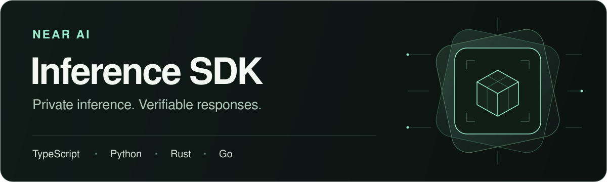

<p align="center">
  
</p>

<p align="center">
  <strong>Build with familiar APIs. Verify the infrastructure and the response.</strong><br>
  Attestation, response signatures, and optional encryption for NEAR AI Cloud.<br>
  Available in TypeScript, Python, Rust, and Go.
</p>

<p align="center">
  <a href="https://github.com/nearai/inference-sdk/actions/workflows/ci.yml"></a>
  <a href="https://www.npmjs.com/package/@nearai/inference-sdk"></a>
  <a href="https://pypi.org/project/nearai-inference-sdk/"></a>
  <a href="https://crates.io/crates/nearai-inference-sdk"></a>
  <a href="https://pkg.go.dev/github.com/nearai/inference-sdk/go"></a>
  <a href="./LICENSE"></a>
</p>

<p align="center">
  <a href="#quickstart">Quickstart</a> ·
  <a href="#sdks-and-installation">Install</a> ·
  <a href="#documentation">Documentation</a> ·
  <a href="./examples/README.md">Examples</a> ·
  <a href="https://github.com/nearai/inference-sdk/releases">Releases</a>
</p>

## Why NEAR AI Inference SDK?

- **Verify before you send.** Check the Gateway's attestation and supported model
  deployments before inference, with reusable verification caches.
- **Verify what comes back.** Check response signatures against the exact request
  and response bytes retained by the client, including streamed responses.
- **Add encryption where you need it.** Enable field-level end-to-end encryption
  (E2EE) for supported Chat models, or OHTTP for the HTTP exchange with the Gateway.
- **Keep familiar APIs.** Use Chat Completions, Responses, Anthropic Messages, and
  System One across all four languages, with [official SDK integrations](./examples/README.md#entry-points)
  where available.

## SDKs and installation

| Language | Install | Get started |
| --- | --- | --- |
| **TypeScript / JavaScript** | `npm install @nearai/inference-sdk` | [Node.js & browser guide](./js/README.md) |
| **Python** | `pip install nearai-inference-sdk` | [Python guide](./py/README.md) |
| **Rust** | `cargo add nearai-inference-sdk` | [Rust guide](./rs/README.md) |
| **Go** | `go get github.com/nearai/inference-sdk/go` | [Go guide](./go/README.md) |

See each language guide for runtime requirements and configuration.

## Quickstart

Send an encrypted Chat completion and verify its signature before displaying the
answer. This example uses Node.js **24.22.1+** and the package installed above.

Set your [NEAR AI Cloud](https://cloud.near.ai/) API key in your server environment:

```sh
export NEARAI_API_KEY='your-api-key'
```

Save as `chat.mjs` and run with `node chat.mjs`:

```js
import { InferenceClient } from '@nearai/inference-sdk/node';

const apiKey = process.env.NEARAI_API_KEY;
if (!apiKey) throw new Error('Set NEARAI_API_KEY before running this example');

const client = new InferenceClient({ apiKey, e2ee: true });

const completion = await client.chat.completions.create({
  model: 'z-ai/glm-5.3-flash',
  messages: [{ role: 'user', content: 'Hello!' }],
});

// Verify the signature before using the answer.
const verified = await client.verifyResponse(completion.id);
console.log(`Verified ${verified.signatureKind} response`);
console.log(completion.choices[0]?.message.content ?? '');
```

Choose a model available in your Gateway's catalog that supports NEAR model
attestation. This example explicitly enables E2EE; unsupported models are rejected
before Chat is sent. The Node entry point also binds the Gateway's TLS identity
to its attestation.

Prefer another language? Start with [Python](./py/README.md#send-and-verify-a-chat-completion),
[Rust](./rs/README.md#send-and-verify-a-chat-completion), or
[Go](./go/README.md#send-and-verify-a-completion). For streaming and official SDK
adapters, explore the [runnable examples](./examples/README.md).

## How verification works

1. **Check the deployment.** The Gateway client verifies Gateway evidence and
   model evidence when supported. Required verification failures stop the request.
2. **Send the request.** The client retains the exact request and response bytes
   needed for signature verification. E2EE and OHTTP are optional and disabled by
   default; their scope depends on the API.
3. **Verify the response.** Call `verifyResponse()` (or your language's equivalent)
   before using the answer. For streaming, consume the entire stream first.

A `provider_tee` signature binds those bytes to an attested model signer; a
`gateway` signature binds them to an attested Gateway signer. Gateway signatures
do not prove model TEE execution. See the [verification guide](./js/docs/verification-guide.md)
for encryption scope, deployment policies, and trust boundaries.

Use **Gateway clients for production integrations**. Direct model clients are
experimental; see the limitations for
[TypeScript](./js/docs/verification-guide.md#use-a-direct-model-endpoint),
[Python](./py/docs/verification-guide.md#direct-model-endpoints),
[Rust](./rs/docs/verification-guide.md#experimental-direct-endpoints), and
[Go](./go/docs/verification-guide.md#experimental-direct-endpoints).

## Documentation

| SDK | Verification guide | API reference |
| --- | --- | --- |
| **TypeScript / JavaScript** | [Encryption, streaming & policies](./js/docs/verification-guide.md) | [Types & methods](./js/docs/api-reference.md) |
| **Python** | [Encryption, streaming & policies](./py/docs/verification-guide.md) | [Types & methods](./py/docs/api-reference.md) |
| **Rust** | [Encryption, streaming & policies](./rs/docs/verification-guide.md) | [Types & methods](./rs/docs/api-reference.md) |
| **Go** | [Encryption, streaming & policies](./go/docs/verification-guide.md) | [Types & methods](./go/docs/api-reference.md) |

- [Examples](./examples/README.md) — runnable projects for native clients, official
  SDK adapters, and standalone verification.
- [Live E2E tests](./e2e/README.md) — real-service coverage and CI setup.
- [Release process](./RELEASING.md) — package publishing and maintainer checks.
- [Issues](https://github.com/nearai/inference-sdk/issues) — bug reports and feature requests.

## License

[MIT](./LICENSE) © NEAR AI.
